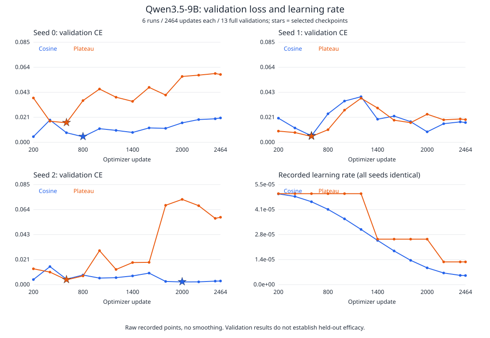

# IntentLab 实验结果报告：规格内诊断改善与闭环控制负结果

日期：2026-10-27。执行依据为初始提交 `d2e9b8f` 的 `idea.md` 及后续用户授权修订。科学运行源码固定为 `20214fb28ba1c8a4a2be0be075c97e33eedb2ba0`。本报告汇总第一轮已完成的模型实验。最新覆盖审计发现三类必需场景未进入正式视图，故 M2 数据覆盖验收与 M8 整体验收仍未完成；详见下文，不将运行结束视为全部研究目标达成。

## 摘要

本轮在单张 RTX 5090 上，以官方 Qwen3.5-9B 原始权重开展规格诊断微调与闭环执行实验。余弦调度微调模型的 test 源任务平均状态错误率为 **1.9410%**，强少样本原始模型为 **20.0104%**；差值为 **−18.0694 个百分点**，任务级 95% 区间为 **[−19.1250, −17.0694] 个百分点**，预登记主比较双侧 p≈0.00009999。

诊断改进没有转化为本轮闭环成功率增益。P1–P4 的 test 合规成功均为 122/200，OOD 均为 3/100；六种纠偏强度条件的结果也相同。进一步检查发现，M7 虽改变请求的 k，但每次实际只选中一个根要求，六条件的实际修复目标没有分离。因此本轮不能有效检验多根修复场景下动态强度的收益。

Plateau 相对余弦的平均测试交叉熵更高，未显示调度优势；规则基线在已编码规格上保持零状态错误。研究结论限于程序生成的明确执行规格，不声称人工验证、开放业务泛化、安全保证或新学习率算法。

## 1. 数据与实验设计

### 1.1 数据规模及标签

|集合|声明源任务数|证据视图数|角色|
|---|---:|---:|---|
|训练|600|2464|微调|
|验证|150|664|提示、控制器及检查点选择|
|test|200|832|输入布局匹配、要求措辞留出的主评估|
|OOD|100|408|两个未见操作族的次要评估|
|合计|1050|4368|同源视图保持在同一集合|

标签完全由离线程序按编码规格及可见证据生成，模型输出不作为 gold。状态为 satisfied、violated、unknown；隐藏历史时的 unknown 不等同于离线完整轨迹上的执行事实。新增自然错误和长历史视图不增加独立源任务数，也不作为人工标注证据。

OOD 的两个操作族为 stable_unique、conditional_group_sum，各 50 源任务。训练、验证与 test 使用另外八个操作族。test 不能描述为已证明严格 IID；数据生成器、固定族配额和跨划分近邻均限制外推。

### 1.2 模型与训练

基础模型 revision 固定为 `c202236235762e1c871ad0ccb60c8ee5ba337b9a`。训练采用 NF4 QLoRA、BF16 计算、rank 16、alpha 32、微批次 1、梯度累积 2，初始学习率 5e-5、最低学习率 5e-6。余弦和 Plateau 各运行种子 0、1、2，共六次正式训练。

每次完成 2464 次优化器更新、4928 次样本暴露、769088 个监督 token 和 13 次完整验证。配对种子的初始化、监督量和采样配置已核对；仅按验证损失选择检查点。Plateau 只接收验证损失，测试结果未用于调参、早停或选择模型。

诊断与闭环推理使用 BF16 基础模型加 LoRA，未使用 4bit 推理。闭环共用冻结的模型版本、上下文可见性及预算：总 token 上限 49152、生成上下文 17408、单次最多 1536 个新 token、最多三轮修复。分析器使用测试前已绑定的余弦 seed 0，未根据测试成绩改选种子。

### 1.3 统计方法

统计单位为源任务；同源视图先聚合，各策略配对，三个训练种子保持固定向量。采用操作族内源任务聚类 bootstrap，2000 次重采样；双侧任务簇符号翻转检验按冻结方案执行。唯一主比较是 RQ1/test，其余 17 项比较使用同一 Holm 校正家族，完整保留全部 18 项结果。

这些区间条件于本轮已训练模型。源簇独立和配对可交换性是推断假设；三个种子的离散程度不等于训练种子总体置信区间。完整精度、逐种子值和检验模式见[注册统计表](../examples/results/formal-m8a-statistics-comparisons/STATISTICS.md)。

## 2. 诊断结果：微调降低状态错误

下表为先在源任务内聚合、再对源任务等权的状态错误率。D/E 各种子均保留，未挑选最优种子。

|条件|test 错误率|OOD 错误率|
|---|---:|---:|
|A：原始模型、完整 Schema|31.7708%|29.0625%|
|B：原始模型、开发集所选少样本|20.0104%|18.1250%|
|C：公开规格驱动的规则分析器|0.0000%|0.0000%|
|D：余弦 seed 0|2.2396%|0.8333%|
|D：余弦 seed 1|2.7083%|5.2708%|
|D：余弦 seed 2|0.8750%|0.8542%|
|D：三种子均值|**1.9410%**|**2.3194%**|
|E：Plateau seed 0|2.2917%|1.6875%|
|E：Plateau seed 1|1.5208%|0.8542%|
|E：Plateau seed 2|3.9792%|5.5833%|
|E：三种子均值|2.5972%|2.7083%|

九条件各 1240 个视图，共 11160 条预测，先封存再揭晓评分。缺失、解析失败和错误均保留。严格接口与归一化接口分别评分；本轮二者合法记录计数相同。OOD 中 B 有 9 条接口失败、D seed 1 有 7 条；E seed 1 在 test 有 1 条失败，E seed 2 在 test/OOD 分别有 10/3 条失败。它们没有从状态错误分母中删除。

|比较|错误率差值|任务级 95% 区间|原始 p|Holm p|
|---|---:|---|---:|---:|
|RQ1/test：D−B|−18.0694 个百分点|[−19.1250, −17.0694] 个百分点|0.000099990001|主比较不进入次要家族|
|RQ1/OOD：D−B|−15.8056 个百分点|[−17.9167, −13.7222] 个百分点|0.000099990001|0.001699830017|

在冻结统计假设下，本批数据支持余弦微调相对强少样本 B 的诊断改进。它不表示优于规则 C，也不直接说明真实任务完成能力或安全性提高。严格接口、混淆矩阵、unknown/violated 召回、不安全 satisfied 及其分母见[完整诊断结果](../examples/results/formal-m5d-diagnostic-results/REPORT.md)。

## 3. 学习率调度：未观察到 Plateau 平均损失优势

余弦三种子分别在第 800、600、2000 步选点；Plateau 三种子均在第 600 步选点。完整曲线保留后期反弹和实际学习率事件，不平滑或截取有利区间。验证最优不等于测试最优。

RQ4 使用目标 token 加权交叉熵，方向固定为 E−D，负值才有利于 Plateau。

|集合|余弦 D 三种子均值|Plateau E 三种子均值|E−D|95% 区间|Holm p|
|---|---:|---:|---:|---|---:|
|test|0.0037828124|0.0056574199|+0.0018746074|[+0.0016978333, +0.0020549955]|0.001699830017|
|OOD|0.0055636444|0.0067777818|+0.0012141374|[+0.0006390145, +0.0017409850]|0.001699830017|

本轮平均效应方向不支持 Plateau 损失优势。种子间仍存在差异，例如 OOD 的 seed 1 有利于 Plateau，不能只保留该种子。调用成熟调度器、发生降率事件或取得较低验证损失，均不能单独作为算法创新或泛化收益的证据。

## 4. 真实闭环：诊断提升未转化为成功率提升

|条件|纠偏策略|独立硬检查|test 合规成功|OOD 合规成功|新增已提交硬违规|
|---|---|---|---:|---:|---:|
|P1|fixed-full|关闭|122/200|3/100|0|
|P2|dynamic-k|关闭|122/200|3/100|0|
|P3|fixed-full|开启|122/200|3/100|0|
|P4|dynamic-k|开启|122/200|3/100|0|

四条件共 1200 次交互。每条件均有 42 个错误运行；初始不可逆违规为 test 4 个、OOD 7 个，完整保留在全任务结果中。初始可行及共同可行子集另报，未替换主要比较分母。

每条件有 28 次修复尝试：9 个完整候选、19 个不完整候选，**完整且合规候选为 0，接受次数为 0**。P3/P4 的独立硬检查各拒绝 7 次，但 P1/P2 同样未接受完整候选。误拦截率的合规候选分母为 0，结果是 **null**，不能报告为 0%。

四条件仍保留基于模型判断的共同接受规则。P1/P2 关闭的是额外独立硬检查，因此 RQ2 测量其在共同接受规则上的增量效果；不能解释为“无任何检查也安全”。独立硬检查仅作用于修复，初始执行不受它保护。代码与拒绝理由核对见[接受规则边界](closed-loop-acceptance-scope.md)。

RQ2 新增硬违规率差和 RQ3 合规成功率差在两个集合均为 0，观测到的配对区间为 [0, 0]、p=1。这是本批执行的退化结果，不是方法等效性证明、零风险保证或硬检查普遍无效的证据。

P1/P3 各使用 1915862 计费 token，P2/P4 各使用 1915708，动态策略只少 154，约 0.008%；test 反而多 1116，OOD 少 1270。该差异不足以支持实质效率收益。M6 监督阶段约 11.20 小时，详见[候选、失败与成本报告](../examples/results/formal-m6c-execution-results/REPORT.md)。

## 5. 动态强度消融：实际干预未分离

M7 保留 fixed-k-1、fixed-k-2、fixed-k-3、dynamic-k、hard优先权重2→1和unknown权重0.5→0六条件，均开启独立硬检查，每条件 300 个任务，共 1800 次交互。

六条件 test/OOD 合规成功率均为 61%/3%，最终文件及事件状态逐任务相同，计费 token 也相同。全部注册成功率比较的差值为 0、p=1。

关键发现是：**每次实际修复都只选中一个根要求**。fixed-k 上限和部分动态请求值虽变化，实际选中的根要求及依赖扩展后的目标序列仍逐任务相同。因此本轮完成了预登记运行，却没有形成可用于检验多根修复收益的有效干预分离。

每条件计费 token 为 1915708，六条件合计 11494248。中断前的三组固定条件 900 条记录原始字节保持；被中断动态组的 39 条记录单独保存，计入额外 250109 token，随后整个动态条件重跑。含中断尝试总计为 **11744357 token**；39 条不计为新增独立样本。完整强度分布、候选机会、初始可行分母、时间及成本见[M7 完整审计](../examples/results/formal-m7c-ablation-results/README.md)。

本结果说明下一轮应先在开发集检查多根修复机会、目标分离和候选合规率，再冻结新的未见测试；本轮没有为挽救正结果而改题、重选模型或修改阈值。

## 6. 补充分析（探索性）

### 6.1 证据支持

原正式引用指标只检查索引存在与非空，不代表引用足以支持状态。正式评估完成后，另按明确编码规格评估“引用构成充分见证”，未调用模型、修改原评分或新增确认性 p 值。

下表为归一化模式下，**gold 已知状态中同时判断正确且证据充分的比例**；先在源任务内聚合，再对具备对应分母的源任务等权。D/E 为三个固定种子的均值，不与覆盖全部三状态的状态错误率直接混用。

|条件|test|OOD|
|---|---:|---:|
|强少样本 B|64.55%|68.69%|
|规则 C|100.00%|100.00%|
|余弦 D 三种子均值|96.54%|93.04%|
|Plateau E 三种子均值|96.20%|93.91%|

unknown 作为弃答单列，不计作已知状态上的证据成功。完整严格/归一化计数、已知状态覆盖、支持精度、unknown 召回及分母见[补充聚合结果](../examples/results/formal-m5e-evidence-support-supplement/README.md)。九条件实际评分与全新目录复算的十个输出文件逐字节一致。该指标只覆盖编码规则，不声称任意自然语言蕴含或人工审核。

### 6.2 输入近邻分层

为检查诊断点估计是否只出现在被输入近邻方法标记的任务中，按评估前已定义的规范化和0.25阈值重建五个分层，mask摘要与原承诺一致后才读取评分。**分层定义在评估前，本次结果分析在测试后，属于探索性分析**，不新增p值或区间。

|分层|源任务数|B错误率|D三种子平均错误率|D−B（百分点）|
|---|---:|---:|---:|---:|
|完整主测试|200|20.0104%|1.9410%|−18.0694|
|与训练规范化完全相同|5|25.0000%|2.9167%|−22.0833|
|与训练距离≤25%|74|19.9043%|1.9332%|−17.9711|
|无训练规范化完全匹配|195|19.8825%|1.9160%|−17.9665|
|与开发来源均无上述近邻|126|20.0728%|1.9455%|−18.1272|

在126个无上述开发近邻的源任务中仍观察到较大点估计差，当前诊断改善并非只出现在被该方法标记的近邻中。但这不证明语义独立或无泄漏，也不消除操作族、难度和共享生成器的影响。完整200源主结果和18项注册统计保持不变，未以126源子集替代主测试。全部九条件、固定种子和分母见[完整分层聚合结果](../examples/results/formal-m2v-overlap-sensitivity/README.md)。

## 7. 核验、交付与公开范围

原注册统计的 analysis、verify、replay、verify-replay 四阶段均成功，原统计和复算报告字节一致。进一步在 Windows 协调机直接从私有归档重算：

- 九条件全部 11160 条预测的诊断评分与原结果一致，规则基线的原始输出也一致。
- M6 的 1200 条、M7 的 1800 条记录，初始/最终状态、候选 oracle 评分及完整评分行与原结果一致。
- 已提交事件、token 账本、强度决策及冻结汇总重算一致；18 项注册统计及完整报告逐字段一致。

这些是使用原编码规格求值器的本地复算，不是第二套独立 oracle、重新生成模型文本或重算模型前向损失。复算入口见[归档统计算术脚本](../scripts/replay_formal_archive_statistics.py)和[原始评分重放脚本](../scripts/replay_formal_archive_scores.py)。

恢复的官方基础权重和六份验证所选适配器已在原 RTX 5090 完成有限前向与有界生成，实际输出已异机校验。首次适配器切换失败及修复记录保留；此检查不证明正式训练断点恢复、长上下文全覆盖或旧输出逐位等价。六次正式训练均正常结束，训练恢复证据来自此前真实 9B 开发短跑，未冒充正式运行恢复试验。

按用户 **2026-10-27 的明确决定**，GitHub 仅公开代码、聚合结果与报告。测试题、程序 gold、参考答案、原始模型输出、生成种子和完整训练状态保持私有。私有数据包及六份完整端点包已在本机交付并逐成员核验；没有发布完整数据 Release。六份所选适配器及共享分词器此前已通过[模型 Release](https://github.com/Jerry-114514/Jerry-new-project/releases/tag/qwen35-9b-m4-adapters-20261027)公开并实际下载校验。

由于原始材料不公开，外部读者目前可以审查代码、聚合结果及方法，不能仅凭公开仓库逐例独立复算全部结果。该限制是当前公开范围，不能将本地复算称为公开独立复现。

### 补充推理资源测量

在原环境中另用公开合成输入测量BF16共享底座双角色容量。为走满允许长度，仅在测量进程临时禁用EOS停止并强制生成指定token数；不读取测试题或gold，不改变冻结科学结果。

|输入token|生成token|角色|秒数|峰值allocated GiB|峰值reserved GiB|
|---:|---:|---|---:|---:|---:|
|1024|256|actor|8.55|17.07|17.36|
|1024|256|analyzer|12.67|17.11|17.40|
|15872|1536|actor|56.31|19.45|20.44|
|15872|1536|analyzer|75.91|20.29|22.86|

四个实际长度均完成，含加载共164.39秒；设备报告总容量31.36GiB。allocated和reserved不能相加。本结果支持当前冻结精度、共享方式和长度预算的合成容量可行性，不是任意输入、训练配置或吞吐的保证；**原M6/M7运行缺失的峰值仍保持缺失，未被本测量回填**。测量受原环境缓存和调用顺序影响，完整数值、源码及异机验证见[补充容量记录](../examples/results/formal-m8e-synthetic-capacity/README.md)。

## 8. 局限与结论

1. **数据来源与依赖。** 任务来自有限操作集合和共享生成器。test/train 存在 6 个规范化完全相同配对，涉及 5 个测试源；165 个近邻配对涉及 74 个测试源，均保留。规范化删除的身份字段可能影响输出，故匹配不直接证明答案泄漏，也不能据不同 ID 证明语义独立。26 个模板标识不是 26 个语义独立模板。构造重放、操作契约去重和程序标签检查已执行，但不能代替场景覆盖验收。正式 4368 个视图中，“隐藏历史但输入快照证明违规”“数据修复后报告过期”“最终存在额外产物”三个明确谓词的计数均为 0，故 **M2 仍未完成**。开发扰动检查不能补算为正式覆盖。更广泛语义独立、源簇统计独立和普遍原创性也未证明。
2. **统计范围。** 结果条件于三个固定训练种子、当前源任务及已编码规则。近邻、固定配额和可交换性假设限制区间解释；低 p 值不等于开放任务泛化。
3. **闭环机会不足。** 完整合规候选为零，M7 实际目标未分离。诊断准确、候选可修复性和最终接受之间存在断点，本轮没有提供动态闭环或独立检查增量收益的有效正证据。
4. **测量缺失与运行事件。** M6/M7 正式推理峰值显存未记录，不以训练或恢复探针回填；部分权重传输与 M7 运行重叠，条件耗时不能直接视作纯策略速度效应。token 和容器时间记录不等于实际账单，中断和额外成本均保留。
5. **标签与公开限制。** 无人工验证、无自然业务测试集、无新环境完整重建证明；私有材料未公开，公共独立复现受限。报告上传本身不等于整体验收；第二轮覆盖候选已有 7428 个视图，上述三类计数分别为 1050、960、1050，但尚未冻结协议或训练评估，不能作为第一轮模型能力证据。后续模型实验须先解决预算与协议安排。

本轮较可靠的结果是：在明确编码规格和本批条件性评估中，余弦 QLoRA 相对强少样本原始模型降低了诊断状态错误，同时保留规则基线更强、Plateau 平均损失无优势和闭环无增益的结果。当前成果适合定位为**规格诊断微调与闭环失效分析的实验报告**，尚不足以支撑新调度算法、动态控制有效性或开放环境安全性的主张。
