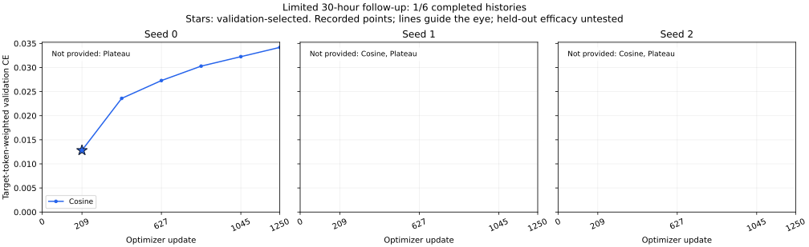
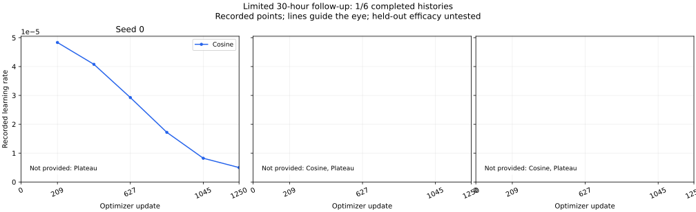

# 受限补充首组已完成训练曲线

2026-10-28快照，仅包含已完成且异机逐成员核验的首组余弦训练。第二组正在运行，其余结果未提供；空白面板不代表零损失或失败。不将这一组快照当作六组调度比较或测试集改善证据。





全部六次验证的原始标量记录见[training-history.json](training-history.json)，选点和缺失列表见[summary.json](summary.json)，公开文件校验见[SHA256SUMS.txt](SHA256SUMS.txt)。星号为按验证损失首次最小值选中的209步，loss约0.01281；1250步loss约0.03418。连线仅帮助阅读，没有平滑、补点或基于曲线重新训练。未采集的逐更新损失/学习率不由这些六点曲线推断。

绘图工具：[render_limited_training_curves.py](../../../../scripts/render_limited_training_curves.py)。支持一至六份完整已结束训练历史，要求保留本轮全部六次验证和215880个验证目标token；各种子分别绘制学习率，允许Plateau因反馈产生不同轨迹。公开历史仅保留step、验证loss/target_tokens、lr_used四种标量，不序列化其他元数据。需可用的matplotlib，训练环境和冻结执行代码保持不变。

```sh
python scripts/render_limited_training_curves.py --history examples/results/coverage-30h-execution/curves-first-completed/training-history.json --out /path/to/new-output-directory
```

本工具只读取训练验证标量并生成报告，不读取留出题目或gold，不调用模型，不改变选点或时限。完整诊断和M1–M8剩余事项仍以[执行记录](../README.md)及[idea.md](../../../../idea.md)为准。
