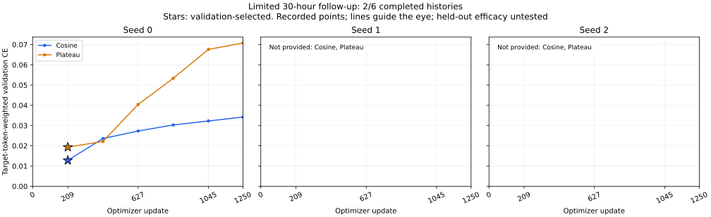
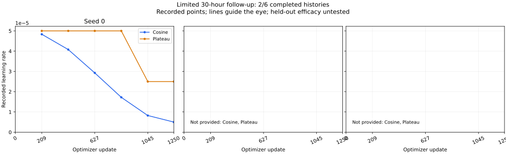

# 本轮首个调度配对：训练验收与曲线

2026-10-28 10:15（北京时间）验收快照。余弦与Plateau的首个配对均完成1250更新、2500次样本暴露、389407监督token及6次完整验证。两份完整端点归档均已异机复制并逐成员校验；相同初始化、训练数据、样本暴露列表及除调度外的配置实际核对一致。第三组训练的真实进程已确认存活，其余三组尚未启动。本页不是全部六组的完成报告。

|已完成条件|验证所选步|最低验证CE|末步验证CE|实际Plateau降率次数|
|---|---:|---:|---:|---:|
|余弦，第一个配对|209|0.01280950|0.03418033|不适用|
|Plateau，第一个配对|209|0.01932600|0.07077661|1|

Plateau在第836步验证后将学习率从0.00005降至0.000025；该行`lr_used`记录验证前已用于训练的学习率，后续记录点才反映新学习率。因此，图中记录点连线不是每一步学习率事件的完整轨迹。该降率晚于所选的209步，不能将本组所选检查点的表现归因于这次降率。两组验证CE均在早期最小值后上升，保留过拟合迹象，不据此改变本轮冻结配置。

完整六点标量见[training-history.json](training-history.json)，配对配置、样本暴露、归档验收及降率事件的聚合凭据见[aggregate-acceptance.json](aggregate-acceptance.json)，选点和未提供历史列表见[summary.json](summary.json)，文件校验见[SHA256SUMS.txt](SHA256SUMS.txt)。参数配置一致性不等于记录了每一条逐更新随机数轨迹；此处没有用不同源数冒充独立重复，也不推断训练种子总体显著性。

两组训练调用各约1.91小时，实际峰值allocated均约20.60 GiB、reserved均约24.09 GiB，二者不能相加。完整优化器状态、原始配置及私有训练记录保留本地和服务器，不公开测试题、gold、种子流或模型状态。未解封本轮模型预测、未执行新测试比较或假设检验；全量闭环/控制与完整2114视图诊断仍保留待办。

绘图与验证仅使用已完成训练标量，复绘入口：[render_limited_training_curves.py](../../../../scripts/render_limited_training_curves.py)。首个准备脚本因把配置字段`schedule`误写为`scheduler`而失败，原失败记录保留在私有运行目录；修正字段后使用新目录验收，没有重新训练或修改科学输入。[首组单条件历史快照](../curves-first-completed/README.md)继续保留。
