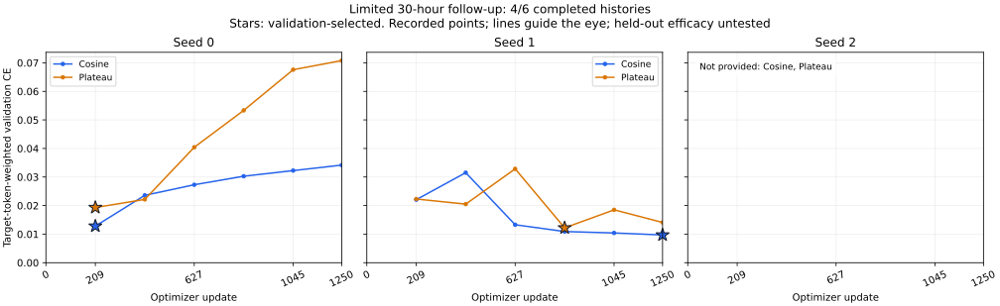
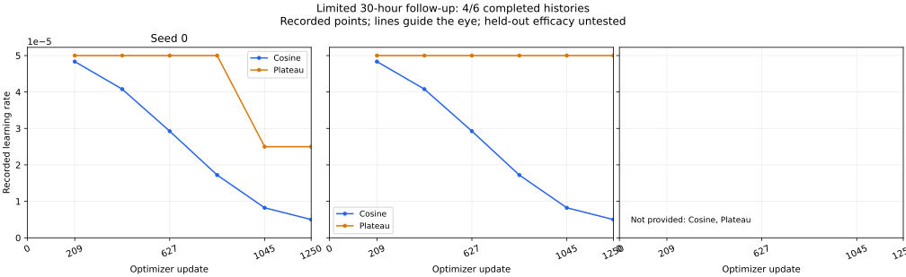

# 本轮前两个调度配对验收

2026-10-28 14:40（北京时间）快照，4/6组训练及其完整异机归档已验收，第五组真实训练进程存活，第六组尚未启动。两个配对各自的初始化、除调度外配置、训练数据及2500条单次暴露记录一致；各组均完成1250更新、389407监督token及6次完整验证。40个归档成员逐一校验通过，没有加载模型或优化器，没有读取新测试结果。

|条件|验证所选步|最低验证CE|末步验证CE|Plateau降率次数|
|---|---:|---:|---:|---:|
|余弦 seed 0|209|0.01280950|0.03418033|不适用|
|Plateau seed 0|209|0.01932600|0.07077661|1|
|余弦 seed 1|1250|0.00970552|0.00970552|不适用|
|Plateau seed 1|836|0.01219720|0.01408531|0|

第二个配对的最佳点明显晚于第一个配对，故不能把seed 0的早期最小值概括为所有种子都应提前停止。Plateau seed 0在836步验证后降率一次；seed 1没有降率事件，不能将它的表现归因于实际降率。保留各种子差异，不据此调整冻结超参数，不执行不完整种子集上的新确认性检验。

标量历史见[training-history.json](training-history.json)，完整训练验收与降率事件的聚合投影见[aggregate-training.json](aggregate-training.json)，选点及尚未提供的两组历史见[summary.json](summary.json)，文件校验见[SHA256SUMS.txt](SHA256SUMS.txt)。学习率连线仅连接验证步记录的`lr_used`，降率发生于该步验证后，不能将连线当成每一步学习率轨迹。

实际生成入口为[统一归档验收工具](../../../../scripts/summarize_limited_training_runs.py)及[绘图工具](../../../../scripts/render_limited_training_curves.py)。输入使用已有私有协议、端点回执与完整归档；这里仅公开标量投影。未知或未提供组别留空，程序标签不冒充人工验证。本轮仍没有新的测试、全量闭环/控制或M8完成声明。
