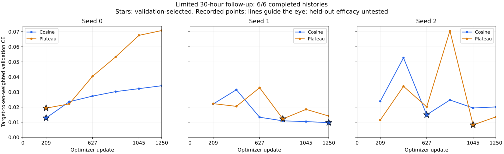
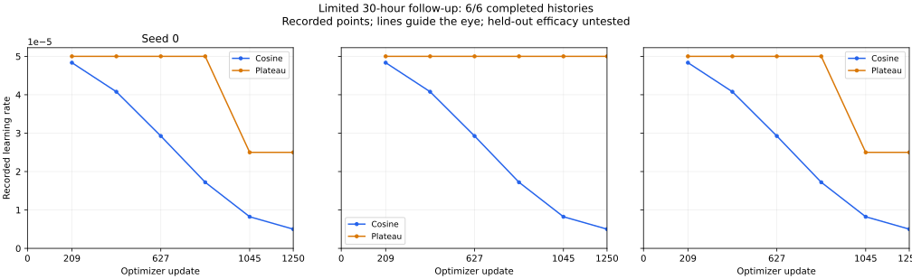

# 30小时受限补充：六组训练完成与诊断交接

2026-10-28 17:55（北京时间）验收快照。余弦/Plateau各三个种子共6/6组训练全部完成，六份完整端点已异机复制，60个归档成员逐一校验通过；三组配对的初始化、除调度外配置、训练数据与样本暴露记录一致。所选模型绑定在首次生成声明之前完成，诊断生成进程已实际运行。本页不报告尚未完成的新测试结果。

|条件|验证所选步|最低验证CE|末步验证CE|Plateau实际降率次数|
|---|---:|---:|---:|---:|
|余弦 seed 0|209|0.01280950|0.03418033|不适用|
|Plateau seed 0|209|0.01932600|0.07077661|1|
|余弦 seed 1|1250|0.00970552|0.00970552|不适用|
|Plateau seed 1|836|0.01219720|0.01408531|0|
|余弦 seed 2|627|0.01490291|0.02011955|不适用|
|Plateau seed 2|1045|0.00819929|0.01353579|1|

每组均为1250更新、2500次样本暴露、389407监督token、6次完整验证，每次验证215880目标token。合计7500更新、15000次暴露、2336442监督token和36次完整验证。六次调用所记训练/验证循环累计约11.41小时，**不是新增实例计费时长**：保守30小时计时仍包含此前准备、等待、加载及传输，不用训练循环之和替代它。峰值allocated最高约20.60 GiB、reserved最高约24.09 GiB，二者不相加。

配对种子存在明显差异：seed 0两条件的最佳点都在209步，seed 1余弦的最佳点在最后一步，seed 2的最佳点又不同。Plateau seed 0和seed 2均在836步验证后降率一次，seed 1没有实际降率。seed 2的所选点在降率之后只能说明时序，不能单凭这一组归因于反馈降率。保留全部轨迹，不据验证曲线改变本轮冻结配置，不在这里增加确认性检验。

## 绑定及来源验收

[aggregate-training.json](aggregate-training.json)保留全部六组标量验收及降率事件，[training-history.json](training-history.json)保留完整36个验证点，[summary.json](summary.json)保留验证选点且未提供组别为空，[SHA256SUMS.txt](SHA256SUMS.txt)校验公开投影。

[diagnostic-handoff.json](diagnostic-handoff.json)记录原科学源码与原执行工具、训练及公开提示输入、六份模型绑定和三组初始化配对已核验，模型绑定文件早于首次生成声明；生成ACK与实际子进程绑定一致。该验收时生成清单仍为running、gold_loaded=false，首次评分声明尚不存在。这里证明的是编码流程和文件顺序，不声称操作系统物理隔离或第三方预注册认证。

本轮在用户批准的[资源修订](../../../../docs/coverage-30h-resource-reallocation-proposal.md)下完成：补充协调器接管同一第五组进程，第六组按原配置仅启动一次；原始时钟、总30小时与费用守护不变，没有重训或删除旧归档。完整协议、模型状态及逐例材料继续私有。复算入口为[归档验收工具](../../../../scripts/summarize_limited_training_runs.py)与[绘图工具](../../../../scripts/render_limited_training_curves.py)。

## 尚未完成

300源九条件诊断生成、完整封存后程序gold评分、六模型目标损失、四项注册统计、全部原始评分复算、最终私有包和本轮结果报告仍在后续流程中。完整2114视图诊断和全量新闭环/有效控制干预继续保留待办，不由六组训练完成推断M2或M8整体验收完成。
